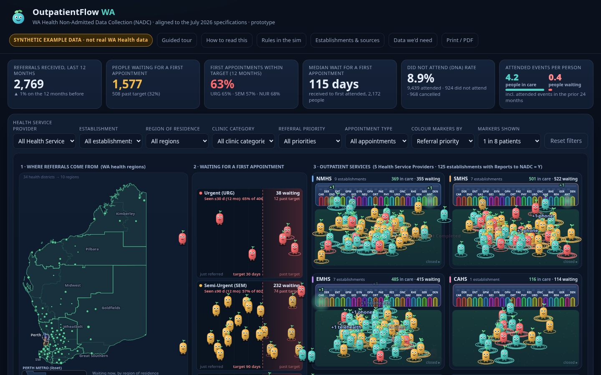

# OutpatientFlow WA

**An animated picture of how referrals move through Western Australia's public hospital outpatient services: who is waiting, who is being seen, and who does not turn up.**

> ⚠️ **SYNTHETIC EXAMPLE DATA.** Every person, referral, appointment, wait time and count in this demo is invented by a seeded random generator. The *structure* (field names, code sets, priority timeframes) follows the WA Health Non-Admitted Data Collection (NADC) documents, and the *establishments and boundaries* are public reference data. Nothing here describes real activity at any hospital, clinic or person.

**Live demo:** https://metadata-team-member.github.io/OutpatientFlow-WA/

**Documents:** [Sources and what was (not) obtained](docs/SOURCES.md) · [Establishments](docs/ESTABLISHMENTS.md) · [Business rules summary](docs/BUSINESS-RULES-SUMMARY.md) · [Open questions for the custodian](docs/OPEN-QUESTIONS.md) · [Data requirements](docs/DATA-REQUIREMENTS.md) · [Dictionary mapping](docs/DATA-DICTIONARY-MAPPING.md) · [Official excerpts](docs/OFFICIAL-EXCERPTS.md) · [Research log](docs/RESEARCH-LOG.md)



## The idea

Every little character is one referral.

1. **Map.** Referrals start in the WA health region of residence (10 regions, real boundaries), with a Perth metro inset. Establishments sit at their real coordinates.
2. **Queue lanes.** Waiting characters are **slim**. They queue in a lane by referral priority (Urgent, Semi-urgent, Not urgent). A red dashed line marks the Business Rules timeframe (30, 90 and 365 days), and each lane shows the share of first attended appointments seen within it.
3. **Inside the network.** Five Health Service Provider cells (and an establishment spotlight) show activity. When a person has an appointment they walk to a clinic door, the door glows, and they **grow broader** with every *attended* appointment (an appointment outcome was allocated).
4. **Did not attend and cancelled.** A missed appointment flashes amber; a cancellation is grey. Telephone and telehealth appear as a beam.
5. **Closure.** The referral closes with a real closure reason (treatment completed, discharge policy, transferred, and so on).

Slim = still waiting, or little care so far; broad = lots of attended care. The simulation opens **paused**; press **Play**.

## What changed in round 2

* **Real establishments.** 117 sites in 5 HSPs (86 hospitals, 31 nursing posts; [list](docs/ESTABLISHMENTS.md)): 112 flagged "Outpatient Reporting" in the WA Government's HEALTH-001 dataset, plus 5 that a verbatim extract of the official WA Health Establishment List shows with "Reports to NADC" = Y but that HEALTH-001 does not flag (Abrolhos Islands, Beacon, Bencubbin, Brookton, Bethesda). Only the first 28 rows of the official list (A to "Cambridge Day Surgery") could be read, so 19 sites are confirmed on it and the rest are not. In that slice HEALTH-001 matched 14 of 19, so the list is probably incomplete. See the [open question](docs/OPEN-QUESTIONS.md).
* **Real geography.** WA outline, 10 health regions and 34 districts (HEALTH-002), simplified, plus a Perth metro inset.
* **Specification-aligned data.** Column names and code sets from the NADC Data Specifications v1.0 (July 2021): Referral Priority AWT/NUR/SEM/UNK/URG, closure reasons, delivery modes, non-attendance and cancellation codes and so on. See [mapping](docs/DATA-DICTIONARY-MAPPING.md).
* **Rule-aware indicators.** Attended = attendance code ATT with an outcome allocated; wait runs from received date to first attended appointment; OPM referrals are excluded from new-appointment wait measures ([summary](docs/BUSINESS-RULES-SUMMARY.md)).
* **HSP view, establishment spotlight, establishment table**, and a "Rules in the sim" dialog that lists what is and is not simulated.
* **Attendance code.** The 2021 Specification has no attendance-status element, but later official documents (Validation Manual, a current Dental Specification) use an Appointment Attendance Code (ATT / DNA / DNW). The simulation generates it. See [official excerpts](docs/OFFICIAL-EXCERPTS.md) (partial, from the search index; edition unknown).

## What the demo includes

* KPI strip: referrals (12 months), waiting for a first appointment, seen within target, median wait, telehealth and did-not-attend shares.
* Charts: wait by priority against target, monthly flow, HSP comparison (in person, telehealth, DNA, cancelled), region comparison, busiest clinics.
* About 11,000 referrals and 36,000 appointments across 95 active establishments, July 2022 to June 2026. Playback runs July 2023 to June 2026.
* Plain HTML, CSS and JavaScript on a canvas. No build step, no framework, no CDN, no tracking.

## Run it locally

```bash
git clone https://github.com/Metadata-Team-Member/OutpatientFlow-WA.git
cd OutpatientFlow-WA
python3 -m http.server 8080      # or: npm run serve
# open http://localhost:8080
```

The site loads `data/synthetic.json`. You do not need Node to view it.

## Regenerate the fake data

Needs Node 18 or newer. The generator is seeded, so the same seed always gives the same data.

```bash
node tools/generate_synthetic.mjs --patients 11000 --seed 20261027   # data/csv/*.csv (git-ignored) and data/sample/*.sample.csv
node tools/build_data.mjs                                            # data/synthetic.json
# or both: npm run data
```

Code sets are in `config/dimensions.json` (from the Specification). The **weights, tiers and scope are invented**. Establishments come from `data/reference/establishments.json`.

## Rebuild the reference data

```bash
node tools/fetch_reference.mjs            # downloads SLIP HEALTH-001/002 into data/reference/raw (git-ignored)
/path/to/python tools/build_geo.py        # needs shapely 2.x; writes wa_regions.geojson, perth_metro.geojson
node tools/build_establishments.mjs       # writes data/reference/establishments.json
node tools/build_establishments_doc.mjs   # writes docs/ESTABLISHMENTS.md
```

## Plug in real data (with approval)

1. Get approval first. See [section 7 of the requirements log](docs/DATA-REQUIREMENTS.md#7-privacy-ethics-and-governance). **Do not commit real data and do not host it on public GitHub Pages.**
2. Produce `referrals.csv` and `appointments.csv` with the columns in [the mapping](docs/DATA-DICTIONARY-MAPPING.md). `data/sample/` has 25-row examples. Header names are case-insensitive, a BOM is fine, and dates may be `DDMMYYYY` (optionally followed by a time), `DD/MM/YYYY` or `YYYY-MM-DD`.
   - Required columns: referrals `ESTABLISHMENT_CODE, REFERRAL_ACCOUNT_NUMBER, REFERRAL_RECEIVED_DATE, REFERRAL_PRIORITY_CODE, DERIVED_HEALTH_DISTRICT`; appointments `REFERRAL_ACCOUNT_NUMBER, APPOINTMENT_DATE, APPOINTMENT_DELIVERY_MODE_CODE`.
   - `--real` has been exercised only against a **small fake extract** (`npm run test:real`), never against real data. Treat the first real run as a trial: read the "Notes" list it prints.
3. Update `config/dimensions.json` with the real code lists if they differ. Codes the file does not know (up to 16 delivery modes and 64 of each other list) are appended automatically and reported, and referrals from unknown establishments or districts are skipped and counted, never silently dropped.
4. Build it:

   ```bash
   node tools/build_data.mjs --referrals my_refs.csv --appointments my_apps.csv --out data/real.json --real
   # optional: --start 2021-07-01 --end 2026-06-30 --sim-start 2023-07-01  (window of at most 2,047 days)
   ```
   Without `--start`/`--end` the window runs from the earliest received date (at most about 5.5 years before the latest) to the latest received date; appointments after it (future bookings) are dropped and counted. Output names must not be `data/synthetic.json`. `data/real*.json` is git-ignored.
5. Open `index.html?data=real.json` from a private server. The banner changes from "SYNTHETIC EXAMPLE DATA" to "Real extract (approved use only)".

## Project layout

```
index.html              page
css/style.css           styles
js/data.js              loads and indexes the data file, derived measures
js/sprites.js           the blob characters
js/scene.js             canvas scene: map, queue lanes, HSP cells, establishment spotlight, playback
js/charts.js            small charts
js/ui.js                filters, KPIs, controls, dialogs, click-card
config/dimensions.json  code sets (from the Specification) and invented weights
tools/                  generators, reference-data builders
data/synthetic.json     what the site loads (synthetic)
data/reference/         establishments and boundaries (public reference data)
data/sample/            25-row sample CSVs in Specification column style
docs/                   sources, establishments, rules summary, open questions, requirements
```

URL options: `?t=2025-03-01` start date, `?autoplay=1`, `?speed=4`, `?density=8` (show 1 in N characters), `?color=stage|spec|region|prio`, `?data=file.json`.

## Honest limits

* Synthetic activity: no real patterns, and no conclusions about real services.
* The Specification and Business Rules were read as **July 2021 v1.0 editions through third-party mirrors**. The Business Rules were read only to section 8.5. The official Data Dictionary was **not obtained**, and the Validation Manual and some other PDFs were seen only as **partial search extracts** ([excerpts](docs/OFFICIAL-EXCERPTS.md)), and a "Business Rules 2024" is cited by the current Outpatient Services Policy (MP 0191/25). See [SOURCES.md](docs/SOURCES.md).
* The establishment list is an inference from a spatial dataset flag, not an official NADC list.
* The URG / SEM / NUR to priority 1 / 2 / 3 mapping and the way a did-not-attend is recorded are assumptions.
* Five clinic category codes (CAR, DER, END, ENT, GAS) are unverified placeholders.
* The characters are a metaphor. They are not people, and nobody should be judged by them.

## Attribution and licence

* Code: MIT. See [LICENSE](LICENSE).
* Establishment and boundary data: © Government of Western Australia, Department of Health, via SLIP (Landgate) / data.wa.gov.au, datasets HEALTH-001 (Health Hospitals) and HEALTH-002 (Health Districts). The catalogue lists the licence as **"not specified"**; reuse is subject to confirmation ([open question 12](docs/OPEN-QUESTIONS.md)). Boundaries are simplified for display.
* "WA Health", "NADC" and related names belong to the Western Australian Department of Health. This is an independent prototype and is not endorsed by it.
